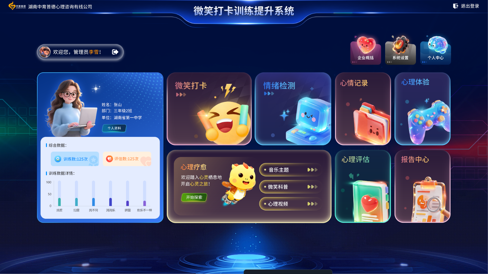

# 情绪识别训练提升系统

基于 Vue 2 + face-api.js 的心理健康与情绪识别训练平台，面向终端用户提供情绪识别、心理评估、放松调节、认知训练等功能，并配套后台管理系统进行资源与用户管理。

## 功能特性

### 用户端

- **情绪识别 / 检测**：调用摄像头，基于 face-api.js 在浏览器端实时检测人脸并识别 7 种表情（愤怒、厌恶、恐惧、高兴、平静、悲伤、惊讶），绘制人脸框与情绪标签，生成情绪报告。
- **微笑打卡**：拍摄 → 情绪分析 → 发布打卡的完整流程，支持打卡统计。
- **情绪打卡与周期**：记录日常情绪，查看情绪周期变化。
- **情绪广场**：用户情绪动态分享与互动社区。
- **心理评估**：在线量表测评，生成测评报告。
- **心理咨询**：专家列表、在线预约、预约与咨询记录管理。
- **心理科普**：心理学科普文章浏览。
- **心理视频 / 微课**：心理视频与微课学习。
- **减压音乐**：音乐疗法播放。
- **放松调节**：眼动脱敏、呼吸球训练等放松训练。
- **认知训练游戏**：翻牌、拼图、眼力大比拼、舒尔特测试、大家来找茬、迷宫、板块迭代、旋转拼图等 8 款训练游戏。
- **报告中心**：情绪报告、测评报告、训练报告等记录与详情查看。
- **多种登录方式**：账号密码、人脸识别、指纹识别登录。
- **个人中心**：个人资料维护、软件设置等。

### 后台管理端

- **训练资源管理**：心理图片、认知资源、音乐疗法、心理视频、心理微课、训练内容、评估量表、科普文章、场景分类等。
- **认知训练管理**：听觉训练、时长感知、逻辑排序、概念认知、基础认知、认知匹配、大小感知。
- **用户管理**：部门 / 班级管理、角色与权限管理、用户增删改查、用户档案（基础资料、教育信息、家庭信息、家庭访谈、精神状态、健康信息、残疾等级）。
- **系统管理**：单位设置与数据同步、高级选项、回收站、系统备份与还原。

## 技术栈

- **框架**：Vue 2.6、Vue Router 3、Vuex 3（含 vuex-persistedstate 持久化）
- **UI 组件库**：Element UI 2.15
- **构建工具**：Vue CLI 5
- **人脸 / 情绪识别**：face-api.js（本地模型：tiny_face_detector + face_expression）
- **图表**：ECharts 5
- **富文本编辑器**：wangEditor 5
- **HTTP 请求**：Axios（封装请求 / 响应拦截、token 鉴权、防重复提交）
- **文档导出**：docxtemplater + pizzip + file-saver（基于 Word 模板生成报告）
- **其他**：spritejs（游戏动画）、vue-cropper（图片裁剪）、html2canvas、jszip、mitt、lodash
- **样式**：SCSS / Sass、Less、postcss-pxtorem（rem 移动端适配）

## 环境要求

- Node.js >= 12（推荐使用较新的 LTS 版本）
- npm
- 后端服务运行于 **8057** 端口（接口基址在 `src/global.js` 中配置）

## 快速开始

```bash
# 安装依赖
npm install

# 启动开发服务（默认 http://localhost:8080）
npm run serve

# 生产环境构建
npm run build

# 代码检查
npm run lint
```

启动后：

- 用户端访问根路径 `/`，默认重定向到登录页 `/login`
- 后台管理端访问 `/index`，需要管理员账号登录

## 目录结构

```
recognition-of-emotion/
├── public/
│   ├── models/            # face-api.js 模型文件（tiny_face_detector、face_expression）
│   ├── docxTemplate/      # Word 报告导出模板（检测报告、测评报告、训练报告等）
│   ├── favicon.ico
│   └── index.html
├── src/
│   ├── assets/            # 静态资源（图片、字体、全局样式）
│   ├── components/        # 公共组件（front 前台 / backstage 后台 / common 通用）
│   ├── mixins/            # 混入（如拍摄相关 shoot mixin）
│   ├── router/            # 路由（frontRouter 前台、backstageRouter 后台、game 游戏）
│   ├── server/
│   │   ├── axios.js       # axios 封装（拦截器、鉴权、防重复请求）
│   │   └── api/           # 按业务模块拆分的接口定义
│   ├── store/             # Vuex 状态管理（user、system 等模块）
│   ├── utils/             # 工具函数（rem 适配、时间格式化、指令、过滤器等）
│   ├── views/
│   │   ├── front/         # 用户端页面
│   │   │   ├── login/     # 登录 / 注册 / 找回密码（含人脸、指纹登录）
│   │   │   └── views/     # 业务页面（情绪识别、打卡、评估、游戏、放松等）
│   │   └── backstage/     # 后台管理页面（首页、训练管理、用户管理、系统设置）
│   ├── App.vue
│   ├── global.js          # 全局配置（后端地址、API 版本号、成功状态码）
│   └── main.js            # 应用入口
├── .env.development       # 开发环境变量
├── .env.production        # 生产环境变量
├── vue.config.js          # Vue CLI 配置
└── package.json
```

## 配置说明

### 后端接口地址

接口基址在 `src/global.js` 中配置，默认取当前主机名的 8057 端口：

```js
let ip = location.protocol + "//" + location.hostname + ":8057/";
```

开发环境如需指向其他后端地址，可在该文件 `development` 分支中修改 `ip`。

### 情绪识别模型

情绪识别功能依赖 face-api.js 的本地模型文件，已置于 `public/models/` 目录：

- `tiny_face_detector_model-shard1`、`tiny_face_detector_model-weights_manifest.json`
- `face_expression_model-shard1`、`face_expression_model-weights_manifest.json`

模型通过 `/models` 路径加载，**不使用远程 CDN**。若模型缺失，情绪识别页面会提示「模型加载失败」。

## 注意事项

- 情绪识别、人脸登录、微笑打卡等功能需要调用摄像头，浏览器需授予摄像头权限。
- `getUserMedia` 在非 localhost 环境下要求 **HTTPS**，部署时请配置 HTTPS 证书。
- 情绪识别核心逻辑封装在 `src/views/front/views/EmotionDetector/composables/useEmotionRecognition.js`（`detection` 模块下有同名实现），采用 Vue Composition API 风格的组合式函数组织。
- 报告导出依赖 `public/docxTemplate/` 下的 Word 模板，请勿随意删除或重命名。

## 预览


